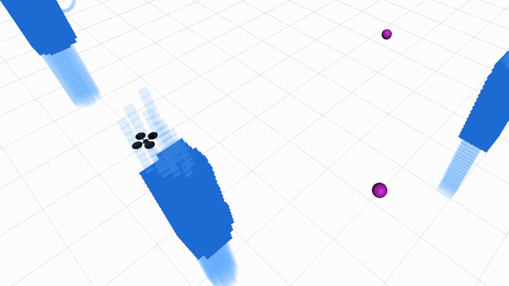
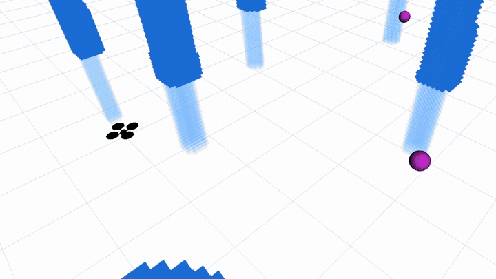

# CINE: Cinematic Intelligent Navigation Engine

[](https://github.com/Kino-Studios/CINE/actions/workflows/ci.yml)
[](LICENSE)
[](https://docs.ros.org/en/jazzy/)

<p align="center">
  
  
</p>

CINE enables a camera drone to fly like a camera operator. A normal obstacle-avoiding planner
gets the drone from A to B safely, but its paths are jerky, it ignores where the subject
sits in the frame, and it does not care if it ends up filming with glare. CINE
takes those safe paths generated by the planner (EGO-Planner) and reshapes them so the drone keeps
its subject on the rule-of-thirds lines, holds a set distance from it, turns away from bright light,
and slows down and smooths out while it is filming.

This repository is the planning half. The sensing half, which runs on the Raspberry Pi 5
on the drone, is [CINE-Sensing](https://github.com/Kino-Studios/CINE-Sensing).

The paper behind both repositories, "CINE: Cinematic Intelligent Navigation Engine using
B-spline trajectory generation and model-based perception" by D. Kosukhin, had its
abstract accepted to AIAA SciTech 2027; the manuscript and project page are at
[kosukhin.com/projects/cine](https://kosukhin.com/projects/cine). If you use CINE in
research, please cite it with [`CITATION.cff`](CITATION.cff) along with EGO-Planner (Zhou
et al., IEEE RA-L 2021). Both entries are in [`references.bib`](references.bib), as is the
other work CINE builds on.

Every flight result so far comes from simulation. On the real drone, the rule-of-thirds
framing has only been bench-tested, with the drone held and moved by hand; CINE has not
flown autonomously yet because the position estimate from the sensing half still drifts
([open issue](https://github.com/Kino-Studios/CINE-Sensing/blob/main/docs/vio-testing.md#open-issue-vio-drift)).
The learned drift correction has a similar limit, since it was trained on simulated drift
alone, and its weights are not published. Three later features (orbit shots, trapezoidal
speed profiles, and light direction from the camera image) are already in the tree,
although the launch files do not start them yet ([list](docs/work-in-progress.md)).

## 1. Prerequisites

CINE runs on Ubuntu 24.04 with ROS 2 Jazzy (Python 3.12). A GPU is optional: only the
Depth Anything 3 depth publisher uses CUDA, and it falls back to the CPU without one.

## 2. Build

```bash
sudo apt install ros-jazzy-desktop ros-jazzy-rmw-cyclonedds-cpp \
  python3-rosdep python3-colcon-common-extensions python3-venv
mkdir -p ~/cine_ws/src && cd ~/cine_ws/src
git clone https://github.com/Kino-Studios/CINE.git
rosdep install --from-paths . -yi --rosdistro jazzy

# pip-only packages, in a venv that can still see the ROS Python packages.
python3 -m venv --system-site-packages ~/cine_ws/venv
~/cine_ws/venv/bin/pip install -r CINE/requirements.txt

cd ~/cine_ws && colcon build --symlink-install
source src/CINE/source_env.sh
```

Every new terminal needs `source_env.sh`, which activates `~/cine_ws/venv` when it exists,
sources ROS 2 Jazzy and then the workspace's `install/setup.bash`, and selects Cyclone DDS.

## 3. Run in simulation

Each command below starts the bundled simulator, EGO-Planner, and the CINE nodes for one
pipeline.

```bash
# Cinematic pipeline: EGO-Planner trajectories reshaped by the cinematic B-spline filter.
ros2 launch cine_bringup cinematic_run.launch.py

# Baseline: plain EGO-Planner trajectories, for comparison.
ros2 launch cine_bringup cinematic_run.launch.py use_cinematic_bspline:=false

# Cinematic pipeline with the learned MLP correction (needs your own weights).
ros2 launch cine_bringup cinematic_run.launch.py use_mlp_correction:=true

# RViz layout for the cinematic displays.
rviz2 -d "$(ros2 pkg prefix cine_bringup)/share/cine_bringup/rviz/cinema.rviz"
```

For the first two commands, `tools/start_simulation.sh [baseline|constrained]` is a
shorter wrapper. Recording runs and downloading the published ones are covered in
[docs/recorded-data.md](docs/recorded-data.md), while the MLP weights and the depth model
have their own page, [docs/mlp-and-depth.md](docs/mlp-and-depth.md).

## 4. Results

Over 15 trials in kinematic simulation, CINE changed the flights as follows:

| What was measured | Without | With |
| --- | --- | --- |
| Peak speed while filming | 3.0 m/s | 1.2 m/s |
| Time the subject stayed within 0.1 m of the focus distance | 23.6% | 76.4% |
| Position error (root mean square), without and with the drift correction | 0.25 m | 0.05 m |

The two recordings at the top of this page show the same comparison, recorded in RViz
in January 2026: plain EGO-Planner on the left, and CINE on the right. In both, the blue
columns are obstacles, the purple spheres are targets, the magenta lines are the planned
waypoint paths, and the thick blue line is the path the drone actually flew.

The full table, along with the bench test on the real camera and the limits of these
results, is in [docs/results.md](docs/results.md).

## 5. Code layout

| Package | Purpose |
| --- | --- |
| `cine_msgs` | The `CinematographyCosts` message: per-term cinematography costs and attitude setpoints. |
| `cine_config` | All tunable constants as JSON in `cine_config/config/`, read by a Python module and a C++ library. `CINE_CONFIG_ROOT` points it at another config directory. |
| `cine_agent` | Cost functions, the cinematic B-spline filter, waypoint generation, simulated sensors and the trajectory data logger. |
| `cine_mlp_correction` | Applies the learned position correction to the cinematic B-spline. |
| `cine_depth` | Publishes Depth Anything 3 depth images, in metres, from the camera feed (optional). |
| `cine_bringup` | The launch file that starts a full pipeline, and the RViz layout. |
| `third_party/ego_planner_swarm/` | Upstream EGO-Planner-Swarm local planner and quadrotor simulator, modified; changes listed in its `UPSTREAM.md`. |

The way these packages pass data to each other is drawn out in
[docs/how-it-works.md](docs/how-it-works.md).

## 6. Contributing

Bug reports and pull requests are welcome. Before sending a pull request, run the checks
listed in [CONTRIBUTING.md](CONTRIBUTING.md), which also describes the code style.

## 7. Acknowledgements

CINE is built on [EGO-Planner-Swarm](https://github.com/ZJU-FAST-Lab/ego-planner-swarm) by
the ZJU FAST Lab, which supplies both the planner and the simulator. Monocular depth comes
from [Depth Anything 3](https://github.com/ByteDance-Seed/Depth-Anything-3) by Lin et al.
(ByteDance Seed), and the quadrotor simulator itself runs on
[Boost.odeint](https://www.boost.org/doc/libs/release/libs/numeric/odeint/) by Karsten
Ahnert and Mario Mulansky. Thanks also to Nicole Spinelli for reviewing the manuscript.

## 8. Licence

CINE is licensed GPL-3.0-only (see [`LICENSE`](LICENSE)). Bundled third-party code keeps
its own licence, and [`THIRD_PARTY_NOTICES.md`](THIRD_PARTY_NOTICES.md) lists each one.
