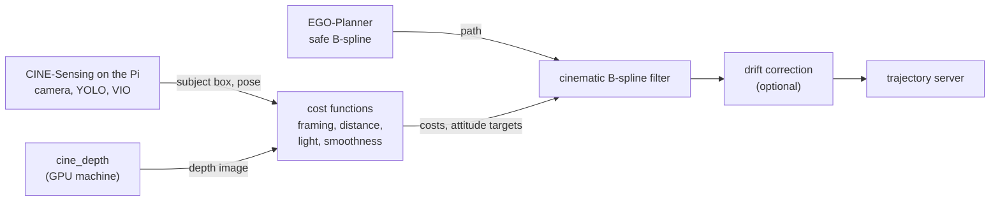
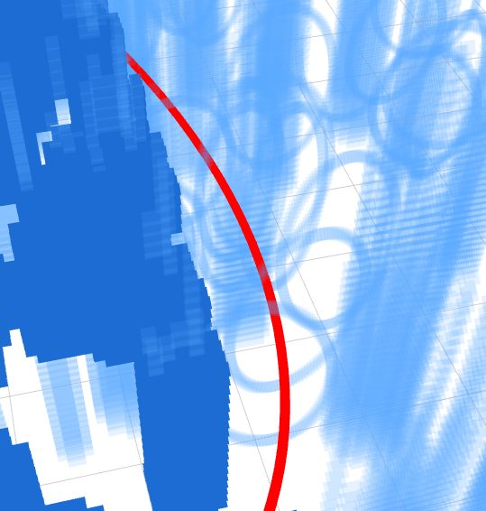

# CINE: Cinematic Intelligent Navigation Engine

<table>
  <tr>
    <td width="50%"></td>
    <td width="50%"></td>
  </tr>
  <tr>
    <td align="center"><em>Baseline: plain EGO-Planner</em></td>
    <td align="center"><em>CINE: the same planner with cinematic reshaping</em></td>
  </tr>
</table>

<p align="center"><em>Simulation in RViz, January 2026. Blue columns are obstacles, purple
spheres are targets, magenta lines are the planned waypoint paths and the thick blue line
is the flown trajectory.</em></p>

CINE enables a camera drone to fly like a camera operator. A normal obstacle-avoiding planner
gets the drone from A to B safely, but its paths are jerky, it ignores where the subject
sits in the frame, and it does not care if it ends up filming with glare. CINE
takes those safe paths generated by the planner (EGO-Planner) and reshapes them so the drone keeps
its subject on the rule-of-thirds lines, holds a set distance from it, turns away from bright light,
and slows down and smooths out while it is filming.

This repository is the planning half. The sensing half, which runs on the Raspberry Pi 5
on the drone, is [CINE-Sensing](https://github.com/Kino-Studios/CINE-Sensing).

- **Paper:** *CINE: Cinematic Intelligent Navigation Engine using B-spline trajectory
  generation and model-based perception*, D. Kosukhin. Abstract accepted to AIAA SciTech
  2027. Manuscript and project page:
  [kosukhin.com/projects/cine](https://kosukhin.com/projects/cine).

## Status

| Part | State |
| --- | --- |
| Cinematic trajectory reshaping (framing, distance, light, speed limits) | **Works in simulation.** Measured over 15 simulated runs; see Results. |
| Learned drift correction (a small neural network) | **Works in simulation**, trained on simulated drift only. Weights are not published. |
| Rule-of-thirds framing on the real camera | **Bench-tested on the drone hardware**, with the drone on the ground and moved by hand. Not flown. |
| Autonomous flight on the real drone | **Not done yet.** The sensing stack runs on the Pi, but its position estimate still drifts (see [CINE-Sensing](https://github.com/Kino-Studios/CINE-Sensing#open-issue-vio-drift)). |
| Orbit shots, trapezoidal speed profiles, light direction from the camera image | **In progress.** In the tree, not started by the launch files; listed under "Work in progress" below. |

## Components

CINE sits on top of [EGO-Planner-Swarm](https://github.com/ZJU-FAST-Lab/ego-planner-swarm)
(ZJU FAST Lab), which plans a collision-free B-spline path and includes the quadrotor
simulator. It is kept in `third_party/ego_planner_swarm/`, with every change listed in its
`UPSTREAM.md`; [`THIRD_PARTY_NOTICES.md`](THIRD_PARTY_NOTICES.md) lists all bundled code.
The `cine_*` packages add:

- **cost functions** (`cine_agent/cine_agent/cost_functions/`) that score a moment of
  flight on four things: framing, distance to the subject, light, and smoothness;
- the **cinematic B-spline filter**
  (`cine_agent/cine_agent/setpoint_adjustment/nodes/cinematic_bspline_filter.py`), which
  takes each path EGO-Planner publishes and moves its control points to keep the subject
  inside the focus radius, then rescales its timing so speed and acceleration stay under
  limits that look smooth on camera;
- the **waypoint generator** that places the shots around the subject
  (`cine_agent/cine_agent/waypoint_automation/`);
- the **learned drift correction** (`cine_mlp_correction/`): a two-layer, 128-unit neural
  network that predicts how far the position estimate has drifted and shifts the path to
  compensate;
- **simulated sensors** (subject detector, focus distance, light source, noisy odometry)
  that let the whole pipeline run without the drone;
- the **data logger and analysis scripts** behind the numbers in the Results section;
- one **configuration package** (`cine_config/`) that both the Python and the C++ code
  read, so a tuning value lives in exactly one place.

## How it works



EGO-Planner finds a collision-free path; CINE then reshapes it. Every planning cycle, the cost node scores the current
view, and the filter bends the next stretch of path toward a better shot and retimes it.
In simulation, CINE's own simulated detector, focus and light publishers stand in for
CINE-Sensing, so this repository runs on its own.

<p align="center">
  
  <br>
  <em>A reshaped trajectory around a target in RViz.</em>
</p>

## Results

From the paper. Unless marked otherwise, these come from **15 trials in kinematic
simulation** (the drone model follows the planned path exactly; there is no aerodynamics).

| What was measured | Without | With |
| --- | --- | --- |
| Peak speed while filming | 3.0 m/s | 1.2 m/s |
| Time the subject stayed within 0.1 m of the focus distance | 23.6% | 76.4% |
| Largest deviation from the focus distance | 0.72 m | 0.31 m |
| Position error (root mean square), without and with the drift correction | 0.25 m | 0.05 m |
| Path points within 10 cm of their target, without and with the drift correction | about 25% | over 95% |
| Camera tilt when a bright light enters the view | 0° | 20°, with the heading turned about 110° away |

**On the real camera (bench test, drone not flying):** with the drone held and moved by
hand, the subject's average distance from its rule-of-thirds target fell from 127.6 px
to 32.5 px (75% lower), and the variance of that distance fell by 98%, over 33 frames
without CINE and 66 with it.

**Limitations.** Every flight result is from simulation. The depth model gives relative
depth, not metres, unless a metric model is used. Cost weights were tuned by hand. CINE
frames one subject at a time. The drift correction was trained on simulated drift, so it
has not been shown to help with the drift the real sensors produce.

**Next.** Fix the real drone's position drift (the open issue in CINE-Sensing), then fly
the same baseline-against-CINE comparison outdoors.

## Supported platforms

| Component | Version |
| --- | --- |
| OS | Ubuntu 24.04 |
| ROS 2 | Jazzy (Python 3.12) |
| Middleware | Cyclone DDS (`rmw_cyclonedds_cpp`, set by `source_env.sh`) |
| Simulator | The quadrotor simulator bundled with EGO-Planner (`third_party/ego_planner_swarm`) |
| GPU | Optional; only the Depth Anything 3 depth publisher uses CUDA, and it falls back to CPU |

## Install

```bash
sudo apt install ros-jazzy-desktop ros-jazzy-rmw-cyclonedds-cpp \
  python3-rosdep python3-colcon-common-extensions python3-venv
mkdir -p ~/cine_ws/src && cd ~/cine_ws/src
git clone https://github.com/Kino-Studios/CINE.git
rosdep install --from-paths . -yi --rosdistro jazzy

# pip-only packages, in a venv that can still see the ROS Python packages.
python3 -m venv --system-site-packages ~/cine_ws/venv
~/cine_ws/venv/bin/pip install -r CINE/requirements.txt

cd ~/cine_ws && colcon build --symlink-install
source src/CINE/source_env.sh
```

`source_env.sh` activates `~/cine_ws/venv` when present, sources ROS 2 Jazzy and then
the workspace's `install/setup.bash`. Source it in every new terminal.

## Quickstart

Each command starts the bundled simulator, EGO-Planner and the CINE nodes for one
pipeline.

```bash
# Cinematic pipeline: EGO-Planner trajectories reshaped by the cinematic B-spline filter.
ros2 launch cine_bringup cinematic_run.launch.py

# Baseline: plain EGO-Planner trajectories, for comparison.
ros2 launch cine_bringup cinematic_run.launch.py use_cinematic_bspline:=false

# Cinematic pipeline with the learned MLP correction (needs your own weights; see below).
ros2 launch cine_bringup cinematic_run.launch.py use_mlp_correction:=true
```

`tools/start_simulation.sh [baseline|constrained]` wraps the first two. With the
simulation running, `tools/collect_baseline_data.sh` and
`tools/collect_constrained_data.sh` record trajectory runs (see "Recorded data"). The
collection scripts start the simulated focus publisher, waypoint generator and logger
themselves with their own parameters, and so they launch the simulation with
`start_cinematography_nodes:=false` to keep a second copy of those nodes from running.
An RViz layout for the cinematic displays is installed with `cine_bringup`:

```bash
rviz2 -d "$(ros2 pkg prefix cine_bringup)/share/cine_bringup/rviz/cinema.rviz"
```

## Packages

| Package | Path | Purpose |
| --- | --- | --- |
| `cine_msgs` | `cine_msgs/` | The `CinematographyCosts` message: per-term cinematography costs and attitude setpoints. |
| `cine_config` | `cine_config/` | All tunable constants as JSON in `cine_config/config/`, read by a Python module and a C++ library. `CINE_CONFIG_ROOT` points it at another config directory. |
| `cine_agent` | `cine_agent/` | Cost functions, the cinematic B-spline filter, waypoint generation, simulated sensors and the trajectory data logger. |
| `cine_mlp_correction` | `cine_mlp_correction/` | Applies the learned position correction to the cinematic B-spline. |
| `cine_depth` | `cine_depth/` | Publishes Depth Anything 3 depth images, in metres, from the camera feed (optional). |
| `cine_bringup` | `cine_bringup/` | The launch file that starts a full pipeline, and the RViz layout. |
| EGO-Planner-Swarm | `third_party/ego_planner_swarm/` | Upstream local planner and quadrotor simulator, modified; changes listed in its `UPSTREAM.md`. |

## Recorded data

The trajectory data logger (`ros2 run cine_agent trajectory_data_logger`) writes one CSV
per run to its `output_dir` parameter, by default `data/trajectories` under the
directory it starts in (the collection scripts start it from the repository root). It
writes one row per sample, taken at 50 Hz from the latest odometry:

| Column | Unit | Meaning |
| --- | --- | --- |
| `time` | s | Odometry stamp minus the first stamped odometry of the run |
| `odom_x`, `odom_y`, `odom_z` | m | Drone position relative to where the run started |
| `odom_vx`, `odom_vy`, `odom_vz` | m/s | Drone velocity |
| `odom_speed` | m/s | Norm of the drone velocity |
| `planned_x`, `planned_y`, `planned_z` | m | Planned position from the current baseline B-spline at the same time, relative to the start; empty before the first plan |
| `planned_vx`, `planned_vy`, `planned_vz` | m/s | Planned velocity; empty before the first plan |
| `planned_speed` | m/s | Norm of the planned velocity; empty before the first plan |
| `cinematic_framing_active` | bool | Whether cinematic framing was active at that sample (absent from the 2025 runs in the release, which predate it) |

While framing, it also writes `distance_<mode>_<timestamp>.csv` with the drone-to-subject
distance, its target and the error against the tolerance.
`tools/analysis/trajectory_stats.py` and `tools/analysis/trajectory_mean.py` summarise
and average the runs in `data/trajectories/baseline` and `data/trajectories/cinematic`.

## MLP correction and Depth Anything 3

**MLP correction.** The trained correction weights are not distributed with this
repository, and so the correction is off by default. To use your own,
`cine_mlp_correction` reads `mlp_correction.onnx`, `mlp_correction.onnx.data` and
`scaler.json` from `cine_mlp_correction/weights/` (git ignores that folder's contents; the
build installs them to the package share). Set `mlp_weights_path` in
`cine_config/config/mlp/mlp-params.json` (or the `mlp_weights_path` launch argument) to
use another directory. Without the model the node passes trajectories through unchanged.
To run it on its own: `ros2 launch cine_mlp_correction mlp_correction.launch.py`.

**Depth Anything 3.** `cine_depth` estimates depth from the camera image with
[Depth Anything 3](https://github.com/ByteDance-Seed/Depth-Anything-3) and publishes it in
metres on `/depth/image_raw`. On the drone it does not run on the Raspberry Pi: it runs on
a separate computer with an NVIDIA GTX 1660 Ti on the same ROS 2 network, which receives
the Pi's camera images and sends the depth back. Its packages are optional and are
installed into the workspace venv; Depth Anything 3 is not on PyPI, and so it is installed
from a pinned commit without its full dependency list (which pulls in 3D-export tools the
node never uses):

```bash
~/cine_ws/venv/bin/pip install --extra-index-url https://download.pytorch.org/whl/cpu \
  -r ~/cine_ws/src/CINE/cine_depth/requirements.txt
~/cine_ws/venv/bin/pip install --no-deps \
  "depth-anything-3 @ git+https://github.com/ByteDance-Seed/Depth-Anything-3@3d835ec1a5802d64a8b8b15f817a1ab54809bfe4"
ros2 launch cine_depth depth_publisher.launch.py
```

Drop the PyTorch CPU index on a CUDA machine. The weights download from Hugging Face on
first start. The node takes these parameters:

| Parameter | Default | Meaning |
| --- | --- | --- |
| `model_id` | `depth-anything/DA3METRIC-LARGE` | Hugging Face model. A `DA3METRIC` model gives depth in metres, using the focal length from `cine_config/config/camera/camera-params.json`; any other model gives relative depth, stretched over 0 to `max_depth`. |
| `process_resolution` | `504` | Longest side, in pixels, of the image the network sees. The output is resized back to the camera resolution. |
| `depth_encoding` | `32FC1` | `32FC1` publishes metres as float; `mono8` publishes depth normalised to 0 to 255. |
| `depth_scale` | `1.0` | Multiplier applied to the depth in metres. |
| `max_depth` | `10.0` | Far end, in metres, of the range relative depth is stretched over. |

The default model has 334M parameters and took about 14 s per 1152×648 frame on an
Apple M-series CPU, and so a CUDA GPU is recommended for anything close to the camera
rate. `depth-anything/DA3-SMALL` is a much lighter option, at the cost of relative depth.
DA3METRIC-LARGE, DA3-SMALL and DA3-BASE are Apache-2.0; the larger Depth Anything 3
models are CC BY-NC 4.0 (non-commercial use only).

## Data and weights download

Large files live in the GitHub Release matching `VERSION`, not in git.
`python3 tools/download_assets.py` fetches all of them, verifies their SHA-256 and places
them where their readers look: recorded trajectories in
`data/trajectories/{baseline,cinematic}/`, their mean trajectories in `data/trajectories/`,
and the January 2026 runs in `data/trajectories/2026-01/`. The MLP weights are not among
them.

`--only <name>` fetches a single file (repeatable); `--dest <dir>` places everything under
another root. A file already present with a different checksum is refused, not
overwritten.

## Work in progress

Early work for later stages. It stays in the tree but is not started by
`cine_bringup`.

- `cine_agent/cine_agent/setpoint_adjustment/nodes/orbit_waypoint_generator_node.py`:
  generates orbit waypoints around the subject from visual-inertial pose and focus depth.
- `cine_agent/cine_agent/setpoint_sender/trapezoidal_setpoint_filter.py`: trapezoidal
  velocity profile for position setpoints, the start of a trapezoidal motion controller.
- `cine_agent/cine_agent/light_vector/vector_analysis.py`: estimates the light direction
  from the camera image.
- `cine_agent/launch/collect_baseline_data.launch.py`,
  `cine_agent/launch/collect_cinematic_data.launch.py`,
  `cine_agent/launch/collect_sim_data.launch.py`: launch-file versions of the data
  collection scripts.
- `cine_depth/launch/depth_publisher.launch.py`: starts the depth publisher, which no
  pipeline uses yet.

## Contributing

```bash
pip install pre-commit && pre-commit install
pytest                              # pure-Python tests, no ROS needed
python3 tools/format.py --check     # whitespace convention
cd ~/cine_ws && colcon test --packages-select cine_config cine_agent cine_mlp_correction
```

Python follows ruff (line length 100, single quotes, Python 3.12) and then
`python3 tools/format.py`. Use descriptive names and keep comments for the non-obvious.
Changes under `third_party/` are recorded in `third_party/ego_planner_swarm/UPSTREAM.md`.
Contributions are accepted under GPL-3.0-only.

## Citation

Cite CINE with the metadata in `CITATION.cff`. Please also cite EGO-Planner
(Zhou et al., IEEE RA-L 2021); `references.bib` has it with the other works CINE builds
on.

## Licence

GPL-3.0-only, see `LICENSE`. Bundled third-party code keeps its own licence; see
`THIRD_PARTY_NOTICES.md`.

## Acknowledgements

- [EGO-Planner-Swarm](https://github.com/ZJU-FAST-Lab/ego-planner-swarm) by the ZJU FAST
  Lab, the planner and simulator CINE builds on.
- [Depth Anything 3](https://github.com/ByteDance-Seed/Depth-Anything-3) by Lin et al.
  (ByteDance Seed), for monocular depth.
- [Boost.odeint](https://www.boost.org/doc/libs/release/libs/numeric/odeint/) by Karsten
  Ahnert and Mario Mulansky, which drives the quadrotor simulator.
- Nicole Spinelli, for reviewing the manuscript.
