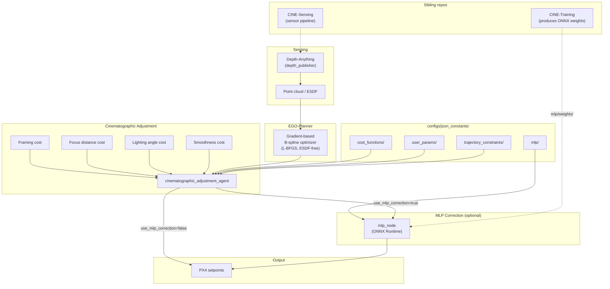

# CINE: Cinematic Intelligent Navigation Engine

Most drone planners treat flight as a collision-avoidance problem. CINE treats it as a directing problem. It takes EGO-Planner's collision-free B-spline trajectory and bends it with cinematographic cost terms -- subject framing, focus distance, lighting angle, motion smoothness -- so the drone moves like a camera operator chose the path, not a shortest-safe-route solver. An optional MLP correction layer, trained in the sibling [CINE-Training](https://github.com/fishnos/CINE-Training) repo, applies a learned residual on top. Output: PX4-compatible setpoints.

---

## Pipeline



---

## Quickstart

<details>
<summary>Prerequisites</summary>

- Ubuntu 24.04, ROS 2 Jazzy, CUDA-capable GPU
- Set CycloneDDS: `echo "export RMW_IMPLEMENTATION=rmw_cyclonedds_cpp" >> ~/.bashrc`

```bash
sudo apt install \
  libpcl-dev libvtk9-dev libeigen3-dev libopencv-dev python3-pip \
  ros-jazzy-rmw-cyclonedds-cpp ros-jazzy-cv-bridge ros-jazzy-pcl-conversions
```

```bash
pip install -r requirements.txt
```

</details>

```bash
# 1. Source ROS 2 + workspace + venv
source source_env.sh

# 2. Build workspace (from repo root)
colcon build --base-paths trajectory-optimization_ws/src mlp/inference

# 3. Download ONNX weights (verifies SHA-256, writes to mlp/weights/)
python scripts/download_weights.py

# 4. Run simulation with cinematographic filter
cd trajectory-optimization_ws
./start_simulation.sh constrained
```

Pure EGO-Planner baseline (no cinematographic filter):

```bash
./start_simulation.sh baseline
```

---

## Configuration

All tuneable parameters live in `configs/json_constants/`. `ConfigLoader` raises `FileNotFoundError` at import time if any expected JSON is absent, naming the missing path.

| Parameter group                          | File                                                             |
| ---------------------------------------- | ---------------------------------------------------------------- |
| Focus distance, framing anchor, drone ID | `configs/json_constants/user_params/params.json`                 |
| Velocity, acceleration, yaw limits       | `configs/json_constants/trajectory_constraints/defaults.json`    |
| Focus-mode velocity/acceleration         | `configs/json_constants/trajectory_constraints/focus.json`       |
| Cost term weights                        | `configs/json_constants/cost_functions/cost-params.json`         |
| Light avoidance                          | `configs/json_constants/light_avoidance/orientation-params.json` |
| Camera intrinsics                        | `configs/json_constants/camera/camera-params.json`               |
| MLP weights path + enable flag           | `configs/json_constants/mlp/mlp-params.json`                     |

---

## MLP weights

```bash
python scripts/download_weights.py
```

Fetches `mlp_correction.onnx`, `mlp_correction.onnx.data`, and `scaler.json` into `mlp/weights/`. To pin a specific release:

```bash
python scripts/download_weights.py --tag v1.2.0
```

---

## Running

```bash
cd trajectory-optimization_ws

./start_simulation.sh baseline      # EGO-Planner only
./start_simulation.sh constrained   # + cinematographic filter
```

Both accept any `ros2 launch` argument. For direct launch with MLP:

```bash
ros2 launch ego_planner cinematic_run.launch.py use_mlp_correction:=true
```

Key launch args: `use_cinematic_bspline` (default `true`), `use_mlp_correction` (from config), `drone_id` (default `0`).

### Data collection

```bash
cd trajectory-optimization_ws
./collect_baseline_data.sh       # saves to trajectory_data/baseline/
./collect_constrained_data.sh    # saves to trajectory_data/cinematic/
```

Override params for a single constrained run without editing JSON:

```bash
cp collect_constrained_data.env.example collect_constrained_data.env
# edit collect_constrained_data.env
./collect_constrained_data.sh
```

### Trajectory analysis

```bash
python scripts/trajectory_stats.py \
  --trajectory-root trajectory_data \
  --datasets baseline cinematic \
  --output-dir trajectory_data

python scripts/trajectory_mean.py \
  --trajectory-root trajectory_data \
  --datasets baseline cinematic \
  --time-step 0.005 \
  --output-dir trajectory_data
```

---

## Troubleshooting

**Build fails -- package not found by colcon**: pass `--base-paths trajectory-optimization_ws/src mlp/inference` from repo root, or run `colcon build` from inside `trajectory-optimization_ws/`.

**`FileNotFoundError` naming a config path**: JSON file missing from `configs/json_constants/`. Error includes full path.

**`FileNotFoundError` naming `mlp/weights/...`**: run `python scripts/download_weights.py`.

**Topics invisible / nodes not communicating**: `ROS_DOMAIN_ID` mismatch. `source_env.sh` sets it to `0`; export the same value in all terminals before sourcing.

---

License: see `LICENSE`. Citation: `reference.bib` (EGO-Planner: Zhou et al., IEEE RA-L 2021).
