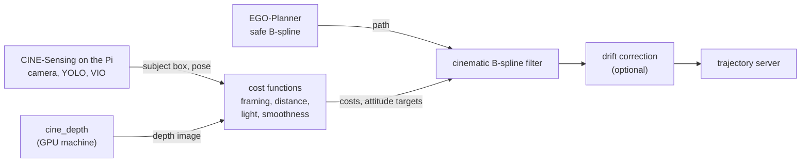

# How CINE works

CINE sits on top of [EGO-Planner-Swarm](https://github.com/ZJU-FAST-Lab/ego-planner-swarm)
(ZJU FAST Lab), which plans a collision-free B-spline path and includes the quadrotor
simulator. It is kept in `third_party/ego_planner_swarm/`, with every change listed in its
`UPSTREAM.md`; [`THIRD_PARTY_NOTICES.md`](../THIRD_PARTY_NOTICES.md) lists all bundled code.
The `cine_*` packages add:

- cost functions (`cine_agent/cine_agent/cost_functions/`) that score a moment of
  flight on four things: framing, distance to the subject, light, and smoothness;
- the cinematic B-spline filter
  (`cine_agent/cine_agent/setpoint_adjustment/nodes/cinematic_bspline_filter.py`), which
  takes each path EGO-Planner publishes and moves its control points to keep the subject
  inside the focus radius, then rescales its timing so speed and acceleration stay under
  limits that look smooth on camera;
- the waypoint generator that places the shots around the subject
  (`cine_agent/cine_agent/waypoint_automation/`);
- the learned drift correction (`cine_mlp_correction/`): a two-layer, 128-unit neural
  network that predicts how far the position estimate has drifted and shifts the path to
  compensate;
- simulated sensors (subject detector, focus distance, light source, noisy odometry)
  that let the whole pipeline run without the drone;
- the data logger and analysis scripts behind the numbers in the [results](results.md);
- a configuration package (`cine_config/`) that both the Python and the C++ code read,
  so each tuning value is set in one place.

## Data flow

EGO-Planner finds a collision-free path; CINE then reshapes it. Every planning cycle, the cost node scores the current
view, and the filter bends the next stretch of path toward a better shot and retimes it.
In simulation, CINE's own simulated detector, focus and light publishers stand in for
CINE-Sensing, so this repository runs on its own. The image below shows one reshaped
trajectory around a target, as RViz draws it.

  

